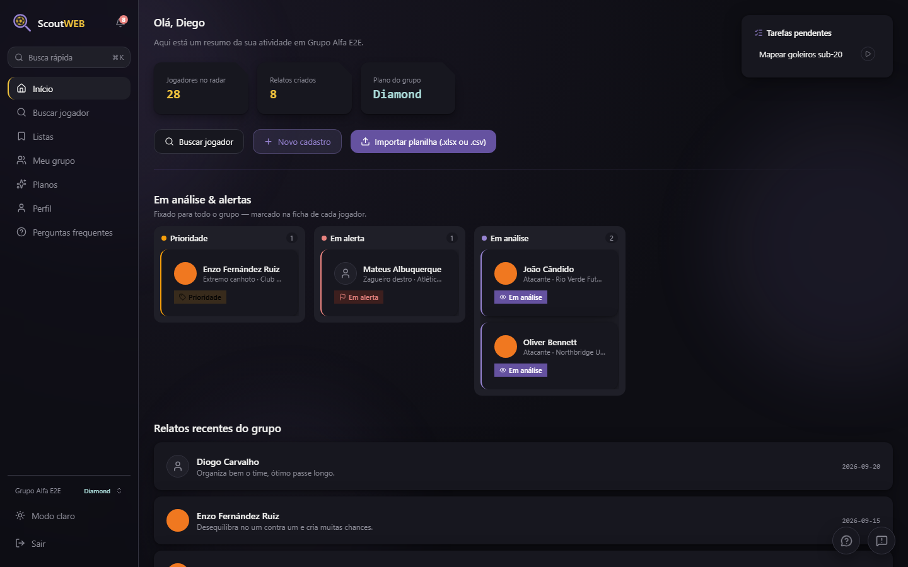
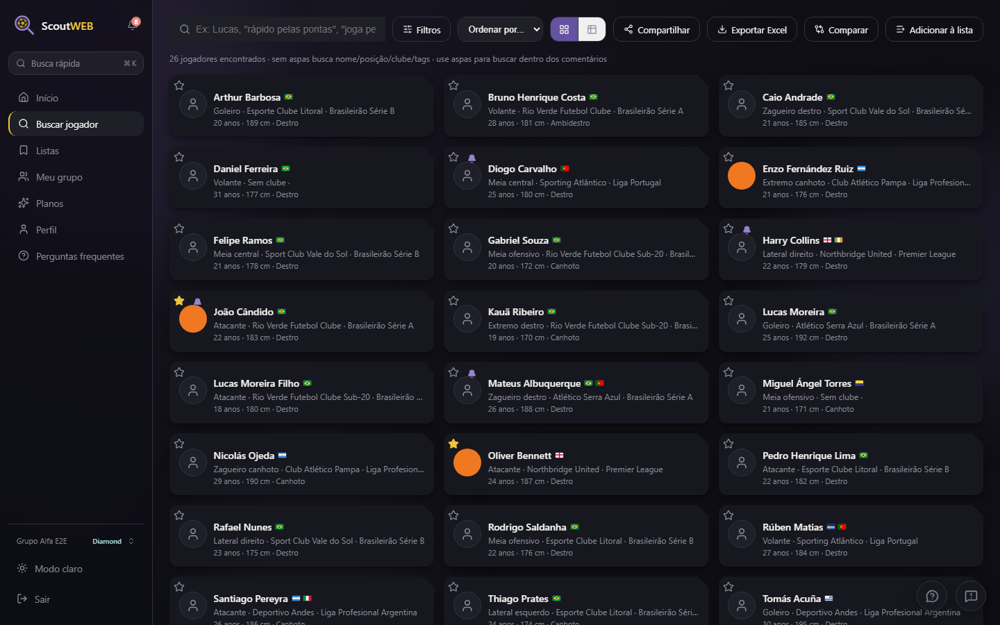
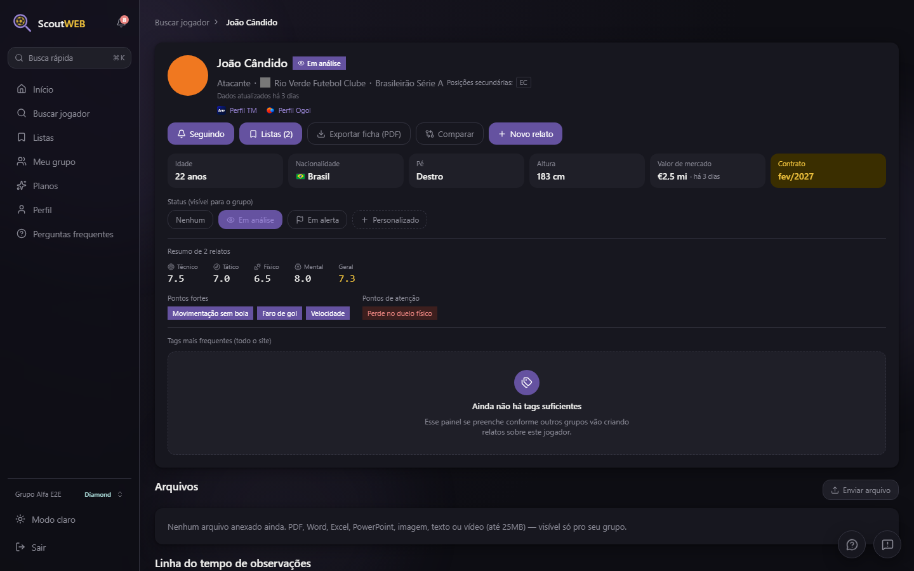
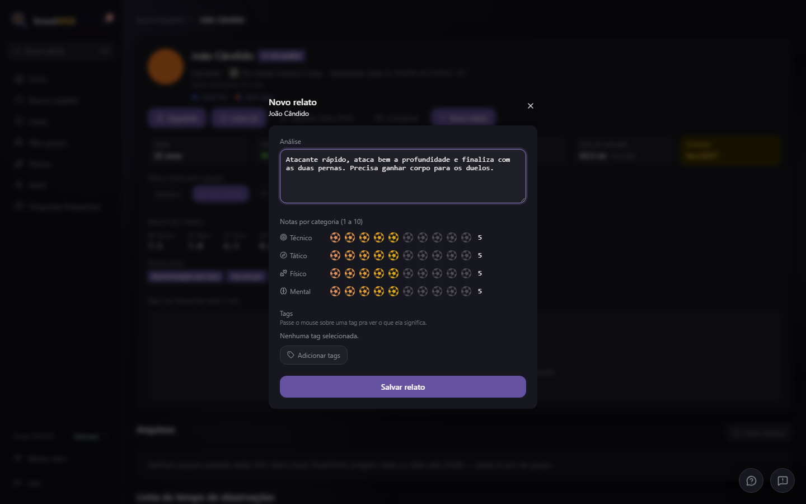
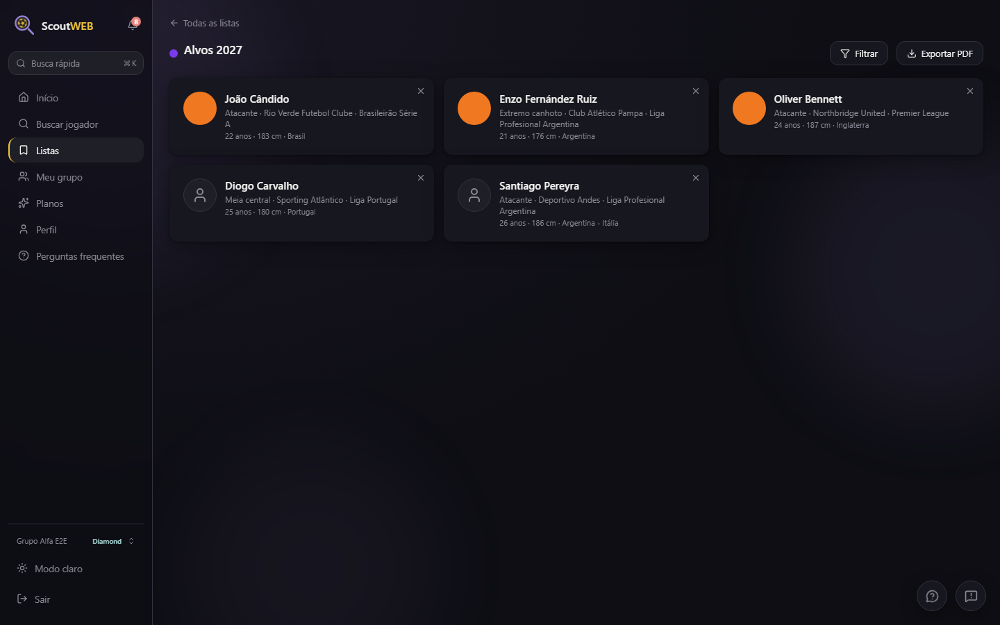
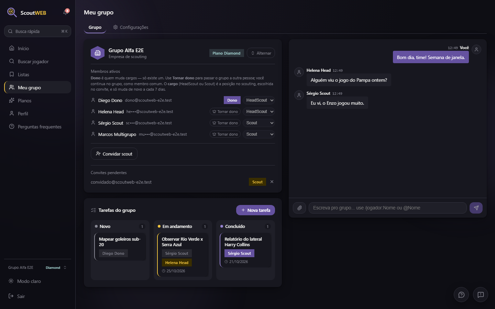
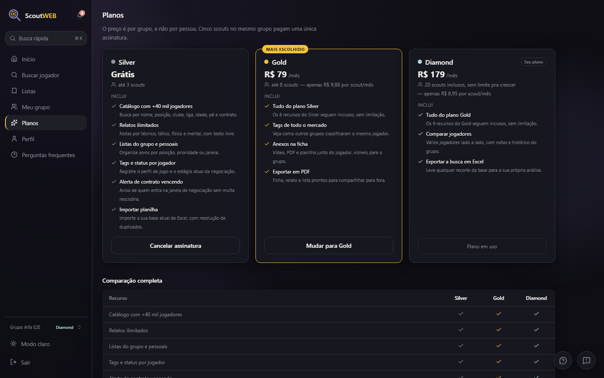
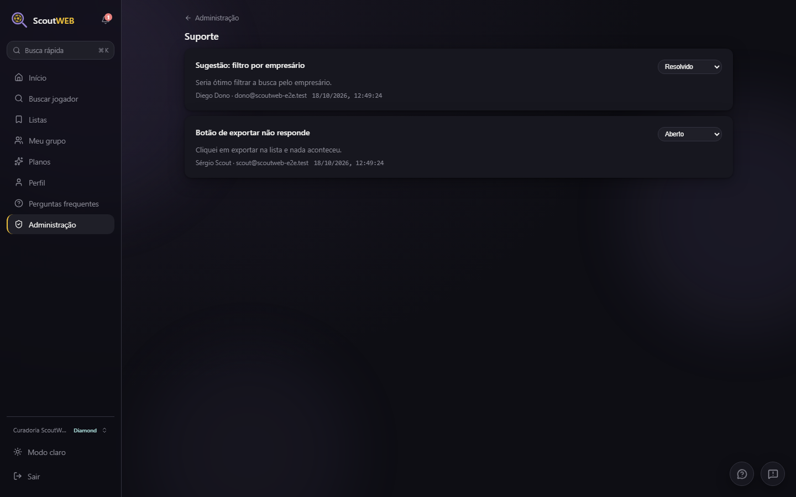
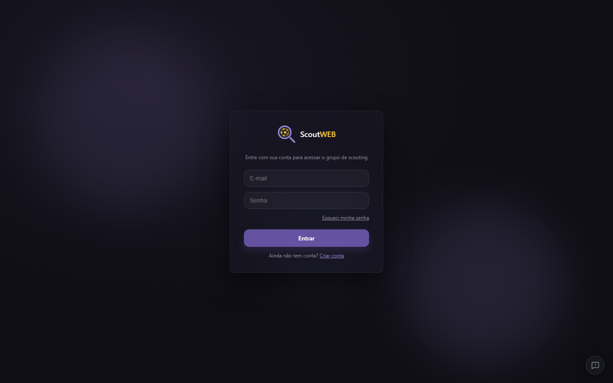
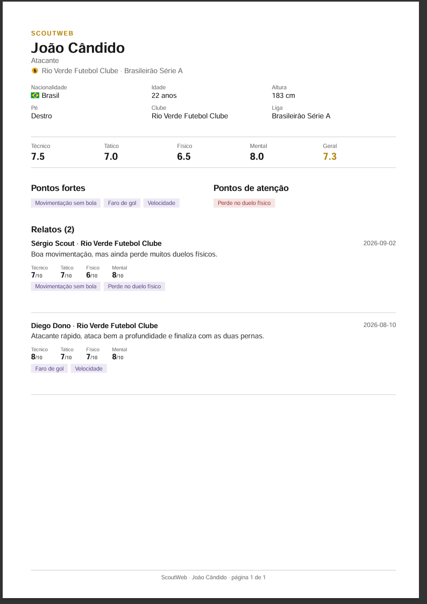

# ScoutWeb

**A mesa de trabalho de quem faz scouting de futebol:** um catálogo com dezenas
de milhares de jogadores e, por cima dele, os relatos, as notas, as listas e
o histórico de negociação de cada grupo, privados e em um lugar só.

  <picture>
    <source media="(prefers-color-scheme: light)" srcset="imagens/dashboard-claro.png" />
    
  </picture>

> **Vitrine do projeto.** O ScoutWeb é um produto em produção, com código
> fechado. Este repositório mostra o que ele faz e como foi construído; o
> código-fonte fica em um repositório privado. Os prints usam dados
> inventados (jogadores, clubes e grupos fictícios) e mudam de tema junto com
> o seu GitHub.

---

## O que dá para fazer

| | |
|---|---|
| 🔎 **Busca** | Nome, posição, clube, liga, idade, pé, altura, contrato e tags, em cartões ou em tabela. Busca dentro dos comentários, link para compartilhar o filtro e exportação em Excel. |
| 🧾 **Ficha do jogador** | Dados públicos de carreira, valor de mercado, alerta de contrato vencendo, status do grupo (em análise, em alerta, prioridade), anexos e a linha do tempo de observações. |
| ✍️ **Relatos** | Notas de 1 a 10 em técnico, tático, físico e mental, texto livre e tags. A ficha resume os pontos fortes e de atenção de todos os relatos. |
| 📄 **PDF** | Ficha, relato e lista exportados em PDF para mostrar a quem está fora do grupo. |
| 📋 **Listas** | Listas do grupo e pessoais (favoritos, "Alvos 2027", ...) com cor, filtro e exportação. |
| ⚖️ **Comparar** | Vários jogadores lado a lado, com notas e histórico. |
| 👥 **Grupo** | Membros e cargos (dono, HeadScout, scout), convites, chat com menção a jogador e quadro de tarefas. |
| 📥 **Importação** | Planilha `.xlsx` ou `.csv` com a base que o grupo já tem, com conferência de duplicatas. |
| 💳 **Planos** | Silver (grátis), Gold e Diamond, por grupo e não por pessoa, com cobrança recorrente (cartão ou Pix). |
| 🛡️ **Admin** | Suporte, assinaturas, atividade do catálogo, fila de clubes duplicados e FAQ. |
| 🔐 **Conta** | Verificação em duas etapas por e-mail, dispositivos conectados, troca de e-mail, exclusão de conta e tema claro/escuro. |

## Telas

<table>
  <tr>
    <td width="50%">
      <picture>
        <source media="(prefers-color-scheme: light)" srcset="imagens/busca-claro.png" />
        
      </picture>
      
<b>Busca</b>

    </td>
    <td width="50%">
      <picture>
        <source media="(prefers-color-scheme: light)" srcset="imagens/ficha-claro.png" />
        
      </picture>
      
<b>Ficha do jogador</b>

    </td>
  </tr>
  <tr>
    <td>
      <picture>
        <source media="(prefers-color-scheme: light)" srcset="imagens/relato-claro.png" />
        
      </picture>
      
<b>Novo relato</b>

    </td>
    <td>
      <picture>
        <source media="(prefers-color-scheme: light)" srcset="imagens/listas-claro.png" />
        
      </picture>
      
<b>Listas</b>

    </td>
  </tr>
  <tr>
    <td>
      <picture>
        <source media="(prefers-color-scheme: light)" srcset="imagens/grupo-claro.png" />
        
      </picture>
      
<b>Grupo: membros, chat e tarefas</b>

    </td>
    <td>
      <picture>
        <source media="(prefers-color-scheme: light)" srcset="imagens/planos-claro.png" />
        
      </picture>
      
<b>Planos</b>

    </td>
  </tr>
  <tr>
    <td>
      <picture>
        <source media="(prefers-color-scheme: light)" srcset="imagens/admin-claro.png" />
        
      </picture>
      
<b>Administração</b>

    </td>
    <td>
      
      
<b>Login</b>

    </td>
  </tr>
</table>

<b>Ficha exportada em PDF</b>

## Destaques de engenharia

- **Multi-tenant de verdade.** O catálogo de jogadores é compartilhado por
  todos os grupos. O que é de cada grupo (relatos, listas, tags, status e
  arquivos) fica isolado por Row Level Security no Postgres, não só por
  filtro no código: mesmo uma consulta errada não vaza dado de outro grupo.
- **Mais de 1.700 testes automatizados.** Cerca de 750 em Vitest (funções e
  SQL, reconstruindo o banco do zero a cada rodada) e mais de 1.000 em
  Playwright, que clicam o site inteiro contra um banco local descartável,
  com os serviços externos simulados.
- **Produção protegida pelo CI.** Toda mudança passa por pull request; a
  branch de produção só aceita merge com tipos, lint, testes, build e a suíte
  E2E inteira verdes. Cada branch ganha um preview contra um banco de staging.
- **Todo bug vira teste.** Cada correção nasce com um teste de regressão que
  falha antes e passa depois, inclusive condições de corrida que só apareciam
  em máquina lenta.
- **Migrations versionadas.** Mudanças de banco são arquivos versionados,
  aplicados em transação por um script próprio, sempre no staging antes da
  produção.
- **Coletor de dados distribuído.** O catálogo é atualizado por um coletor que
  roda fora da nuvem (em um PC ou até em um celular Android), com ritmo
  educado, teto diário por fonte, parada automática em caso de bloqueio e
  conferência de identidade antes de gravar qualquer dado.
- **Busca rápida em escala.** Orçamento de desempenho testado com 20 mil
  jogadores no CI.

Mais detalhes em [arquitetura.md](arquitetura.md).

## Stack

| | |
|---|---|
| **Site** | Next.js 16 (App Router, Server Actions), React 19 e TypeScript |
| **Banco, login e arquivos** | Supabase: Postgres com RLS, Auth e Storage |
| **Hospedagem** | Vercel: preview por branch e produção protegida |
| **Erros** | Sentry |
| **Pagamentos** | Gateway brasileiro com cartão e Pix |
| **PDF** | `@react-pdf/renderer` |
| **Testes** | Vitest (código e SQL) e Playwright (E2E) |
| **CI** | GitHub Actions |

## Demonstração

O site exige login. Para uma demonstração com uma conta de teste, fale comigo
pelo meu perfil do GitHub.

## Licença

© 2026 Enzo Bastos. Todos os direitos reservados. Os textos e as imagens deste
repositório não podem ser reutilizados sem autorização. Veja [LICENSE](LICENSE).
