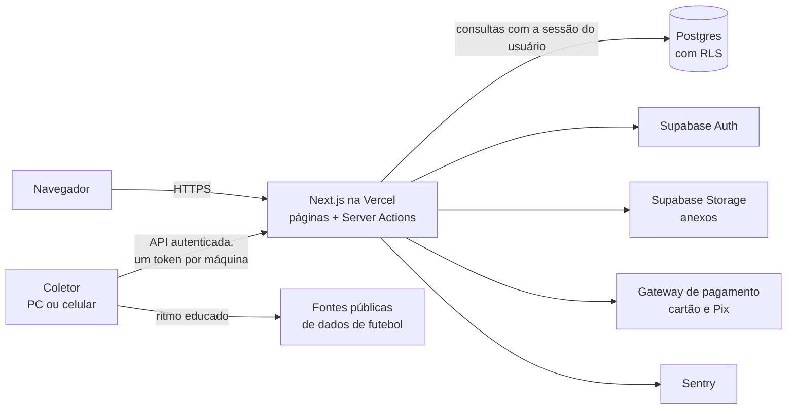
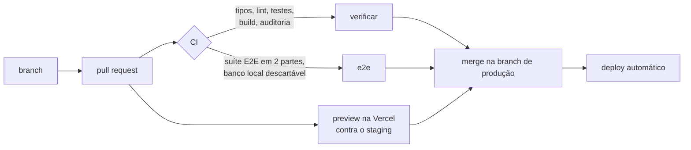

# Arquitetura do ScoutWeb

Visão de alto nível de como o ScoutWeb é construído. O código-fonte é privado;
aqui ficam as ideias e as decisões.

## Visão geral

## Dados: compartilhado × privado

- **Catálogo compartilhado.** Jogadores, clubes e ligas são os mesmos para
  todos os grupos.
- **Camada privada de cada grupo.** Relatos, notas, listas, tags, status,
  arquivos, chat e tarefas pertencem a um grupo. O isolamento é feito por
  **Row Level Security** no próprio Postgres: cada linha sabe de que grupo é,
  e o banco só devolve o que o usuário logado pode ver. Um erro no código da
  aplicação não basta para vazar dado de outro grupo.
- **Funções privilegiadas trancadas.** O que precisa de mais poder roda em
  funções do banco com permissões mínimas, chamadas só pelo servidor, e os
  testes conferem que toda tabela tem RLS ativo.

## Como uma mudança chega na produção

- A branch de produção é **protegida**: sem os checks verdes, o GitHub não
  aceita o merge, nem do dono do repositório.
- Mudanças de banco são **migrations versionadas**, aplicadas por script em
  transação (se falhar no meio, nada fica pela metade), sempre no staging
  antes da produção.

## Testes

| Camada | Ferramenta | O que cobre |
|---|---|---|
| Funções e SQL | Vitest + Postgres em memória | Regras de negócio, permissões, RLS, a reconstrução do banco do zero e o tempo da busca com 20 mil jogadores |
| Site inteiro | Playwright | Mais de 1.000 cenários clicados de verdade: login, busca, ficha, relatos, listas, grupo, planos e admin |

- A suíte E2E roda **só contra um banco local** (Docker) e se recusa a começar
  em outro lugar. Os serviços externos (dados de futebol e pagamento) são
  simulados, então nenhum e-mail real sai e nenhuma cobrança é criada.
- **Todo bug corrigido ganha um teste de regressão**, que falha antes da
  correção e passa depois. Bugs conhecidos ainda não corrigidos ficam
  registrados como testes marcados.

## Coletor de dados

O catálogo é atualizado por um coletor que roda **fora da nuvem**, porque as
fontes de dados bloqueiam IPs de datacenter.

- **Roda em qualquer máquina:** PC (Linux ou Windows) ou celular Android
  (Termux), agendado uma vez por dia.
- **Educado com as fontes:** cerca de uma página a cada 10 segundos, teto
  diário por fonte e respeito ao `robots.txt`. Se uma fonte bloqueia, a coleta
  dela para até o dia seguinte; erro passageiro pausa por 30 minutos.
- **Um coletor por vez:** quem coleta segura uma "posse" renovada a cada
  pedido, e as outras máquinas esperam.
- **Confere antes de gravar:** a página precisa ser do mesmo jogador (mesmo id
  e data de nascimento compatível). Divergências vão para uma fila de revisão
  em vez de sobrescrever o catálogo.
- **Seguro:** cada máquina tem o seu token; o servidor guarda só o hash, e
  tirar uma máquina da lista desliga só ela.

## Stack

Next.js 16 (App Router, Server Actions) · React 19 · TypeScript · Supabase
(Postgres, Auth, Storage) · Vercel · Sentry · Vitest · Playwright · GitHub
Actions
